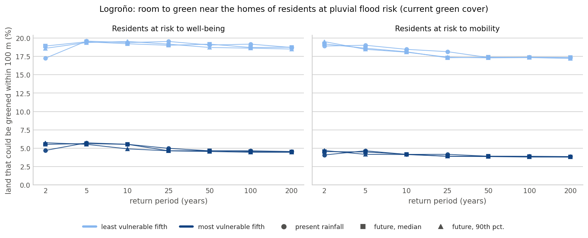

# Room to green near the homes of socially vulnerable residents at pluvial flood risk in Logroño

[](https://github.com/annefou/logrono-vulnerable-room-to-green/actions/workflows/ci.yml)
[](https://annefou.github.io/logrono-vulnerable-room-to-green/)
[](https://github.com/annefou/logrono-vulnerable-room-to-green/pkgs/container/logrono-vulnerable-room-to-green)
[](https://opensource.org/licenses/MIT)
[](https://doi.org/10.5281/zenodo.23302694)
[](docs/fair4rs-checklist.md)
[](https://forrt.org/)
[](nanopubs/PUBLISHED.md)
[](ro-crate-metadata.json)
[](https://archive.softwareheritage.org/browse/origin/?origin_url=https://github.com/annefou/logrono-vulnerable-room-to-green)

> **Do the most socially vulnerable residents at pluvial flood risk in Logroño (Spain) have less room to green near their homes than the least vulnerable?** — one FORRT nanopublication chain.
> Built on the [Logroño flood-adaptation scenarios analysis v0.2.0](https://doi.org/10.5281/zenodo.23302113) ([repository](https://github.com/annefou/logrono-flood-adaptation-scenarios)). Method: [Vogelbacher et al. (2026), NHESS](https://doi.org/10.5194/nhess-26-2765-2026).

**Finding (AIDA):** *In Logroño, the most socially vulnerable residents at pluvial flood risk have less land that could be greened near their homes than the least vulnerable.* With the current green cover, the most vulnerable fifth of residents at risk has on average 4 to 6 % of the land within 100 m of their homes in land-use classes that could be greened, against 17 to 20 % for the least vulnerable fifth: less in all 42 comparisons (3 climates, 7 return periods, 2 risk indices; all p ≤ 0.0002) and in all 492 comparisons across 50, 100 and 200 m and every REACHOUT land cover. The finding is descriptive: it does not show that the lack of room is why city-wide greening helps the most vulnerable least ([greening chain](https://github.com/annefou/logrono-greening-flood-risk-vulnerability)), but it means that protecting them will likely depend on measures other than greening.



## Pipeline

| Step | Notebook | What it does |
|---|---|---|
| 1 | [`01_data_download`](notebooks/01_data_download.py) | Downloads the analysis release (MD5-checked), the Cadastre INSPIRE buildings and Urban Atlas 2018 (neither is committed) |
| 2 | [`02_data_clean`](notebooks/02_data_clean.py) | Land that could be greened within 50 / 100 / 200 m of each assessed building; residents at risk per map |
| 3 | [`03_analysis`](notebooks/03_analysis.py) | Most vs least vulnerable fifth, permutation tests, robustness, cross-check with the release (`results/claim_test.json`) |
| 4 | [`04_figures`](notebooks/04_figures.py) | `figures/main_result.png` |

```bash
git clone https://github.com/annefou/logrono-vulnerable-room-to-green.git
cd logrono-vulnerable-room-to-green
pixi install
pixi run snakemake --cores 1
```

## The chain

Drafts in [`nanopubs/drafts/`](nanopubs/drafts/), the wizard hand-off in [`nanopubs/chain-draft.json`](nanopubs/chain-draft.json), published URIs in [`nanopubs/PUBLISHED.md`](nanopubs/PUBLISHED.md). It extends the greening chain's Outcome (<https://w3id.org/sciencelive/np/RA7f_o-KNPr1Rq2OPPJD47XcUYtPvIRF4rRDqFg-tsZgA>). Sibling chains: [future rainfall](https://github.com/annefou/logrono-future-rainfall-flood-risk), [planned nature-based solutions](https://github.com/annefou/logrono-planned-nbs-flood-risk), [city-wide greening](https://github.com/annefou/logrono-greening-flood-risk-vulnerability).

## Data and credits

Flood maps: Andrea Staccione, Jeremy S. Pal (REACHOUT, CC BY 4.0). Building footprints: derived from data of the Dirección General del Catastro (Catastro INSPIRE licence of access and use, 2016; the original files are not redistributed). Land use: Copernicus Urban Atlas 2018, European Environment Agency. Census: INE.

## Citation

Cite via [`CITATION.cff`](CITATION.cff) → DOI [10.5281/zenodo.23302694](https://doi.org/10.5281/zenodo.23302694), with the analysis [10.5281/zenodo.23302113](https://doi.org/10.5281/zenodo.23302113) and the method paper [10.5194/nhess-26-2765-2026](https://doi.org/10.5194/nhess-26-2765-2026).

Created from [`sciencelivehub/forrt-replication-template`](https://github.com/sciencelivehub/forrt-replication-template); see [`CLAUDE.md`](CLAUDE.md).
